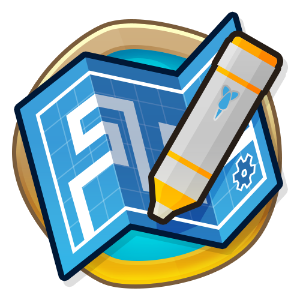

<h1 align="center">
<a href="https://github.com/askryne/btd6-http-api/releases/latest/download/BTD6API.dll">
    
    
</a>
BTD6 HTTP API
</h1>

Establishes a local HTTP server from which you can interact with BTD6: read the game state, send actions, and subscribe to events from any program or programming language.
Useful for building anything that needs to talk to a live BTD6 session, like an AI.

## Installation

[Install MelonLoader and BTD Mod Helper](https://gurrenm3.github.io/BTD-Mod-Helper/wiki/Install-Guide), then drop the mod's `.dll` in your Mods folder.
The server will launch automatically when you start the game.

## Quick example

Python:
```python
>>> import requests
>>> state = requests.get('http://localhost:5001/state/game').json()
>>> state['round']
62
>>> requests.post('http://localhost:5001/action', json={'type': 'startRound'}).json()
{'ok': True}
```

## Full documentation

Refer to `Documentation.md` for a full reference with additional examples.

---

[](https://github.com/gurrenm3/BTD-Mod-Helper#readme)